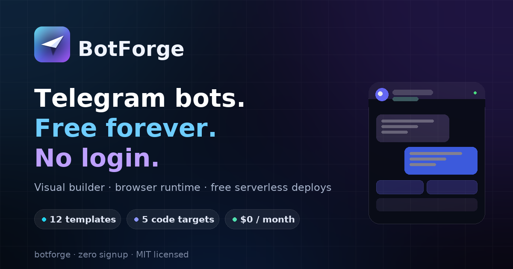

# BotForge — free Telegram bot hosting, no login, unlimited

**A complete Telegram bot platform that runs entirely in your browser.** Design a bot visually, test it instantly, run it from the tab, then generate real standalone code and deploy it to a permanent free serverless tier.

No account. No email. No credit card. No bot limit. No server bill. No lock-in.

[**Open BotForge →**](https://arslanansari1629-blip.github.io/AI/) · [Docs](https://arslanansari1629-blip.github.io/AI/#/docs) · [Templates](https://arslanansari1629-blip.github.io/AI/#/templates)

> ### 📍 One-time step to make the live URL work
> GitHub Pages starts **switched off** for every new repository, and only the repository owner can enable it.
>
> **Settings → Pages → Build and deployment → Source: _GitHub Actions_**
>
> That takes 10 seconds. The included workflow (`.github/workflows/pages.yml`) then publishes the site to **https://arslanansari1629-blip.github.io/AI/** on every push, and retries automatically every 6 hours — no further action needed.
>
> **Want to preview right now, without touching settings?** Clone the repo and run `python3 -m http.server 8080` in its folder, then open `http://localhost:8080`. Any static host works — Netlify Drop, Vercel, Cloudflare Pages, or even a USB stick.

---

## What it does

| Feature | Detail |
| --- | --- |
| 🎛 **Visual builder** | 5-step wizard: identity → token → replies → behaviour → launch. Live preview beside the editor. |
| 💬 **Native rule engine** | 7 match modes (`exact`, `contains`, `starts with`, `command`, `regex`, `any`, `fallback`), template variables, inline keyboards with callbacks and URLs. |
| ⚡ **Browser runtime** | Long-polls `getUpdates` from the tab, answers messages, shows a live console with IN/OUT/ERROR logs. |
| 🧪 **Zero-network simulator** | Test every rule — commands, buttons, fallbacks — without a token, rate limits or Telegram traffic. |
| ☁️ **5 code targets** | Cloudflare Worker, Deno Deploy, Node.js (polling), Python (python-telegram-bot), plus a portable JSON config. |
| 🚀 **Guided free deploys** | Step-by-step instructions, webhook generator, launch checklist for each hosting target. |
| 🧩 **13 templates** | Starter, support desk, mini store, AI knowledge base, welcome gate, course drip, feedback box, restaurant menu, crypto alerts, file drop, booking, polls. |
| 🔐 **Local-first** | Tokens and bots live in `localStorage`. No backend exists to leak them. |
| 📦 **Portable** | Export/import JSON backups; download the whole bot as a `.zip` of runnable source. |
| 📴 **Installable PWA** | Offline-capable service worker, installable on desktop and mobile. |

## How hosting stays free

BotForge itself is a static site (HTML/CSS/JS) — GitHub Pages hosting costs nothing and has no server to fall over. Your bot then runs on one of these:

| Target | Free tier | Mode | Always on |
| --- | --- | --- | --- |
| **Cloudflare Workers** | 100,000 requests/day | webhook | ✅ |
| **Deno Deploy** | 1,000,000 requests/month | webhook | ✅ |
| **GitHub Actions** | 2,000 minutes/month | polling | 6 h per run |
| **Koyeb / Render / Replit** | 1 free service | polling | ✅ (sleep policies vary) |
| **Oracle Always Free** | free VMs | polling | ✅ |
| **This browser tab** | unlimited | polling | while open |

All generated code reads `BOT_TOKEN` from environment variables, so **your token is never written into the source files**.

## Quick start

1. **Create the bot** — open [@BotFather](https://t.me/BotFather) → `/newbot` → copy the token.
2. **Build it** — open the [builder](https://arslanansari1629-blip.github.io/AI/#/builder), paste the token, write replies, hit save. Everything autosaves locally.
3. **Test it** — use the right-hand simulator, or the [runtime](https://arslanansari1629-blip.github.io/AI/#/runtime) to answer real Telegram messages from your tab.
4. **Deploy it** — open [Deploy](https://arslanansari1629-blip.github.io/AI/#/deploy), copy `worker.js` into a free Cloudflare Worker, set `BOT_TOKEN` + `WEBHOOK_SECRET`, then register the webhook:

```bash
curl "https://api.telegram.org/bot<TOKEN>/setWebhook?url=https://<WORKER>.workers.dev/webhook/<SECRET>"
```

That's it — the bot answers 24/7 without your computer being on.

## Live URL

| What | URL |
| --- | --- |
| BotForge app | `https://arslanansari1629-blip.github.io/AI/` *(after enabling Pages — see the note above)* |
| Repository | `https://github.com/arslanansari1629-blip/AI` |

## Self-hosting the site (30 seconds)

Any static host works. For GitHub Pages:

1. Fork this repo (or push it to your own).
2. **Settings → Pages → Build and deployment → Source: GitHub Actions** (the included workflow does the rest), or choose “Deploy from a branch” → `main` → `/ (root)`.
3. Your site appears at `https://<user>.github.io/<repo>/`.

Locally:

```bash
python3 -m http.server 8080
# open http://localhost:8080
```

> ES modules require `http://` — opening `index.html` via `file://` will not work. The service worker needs `https://` or `localhost`.

## Project structure

```
index.html                 app shell (header, footer, palette, background FX)
manifest.webmanifest       PWA manifest
sw.js                      offline service worker (static shell only)
assets/css/base.css        design tokens + primitives
assets/css/app.css         layout + components
assets/js/main.js          router, theme, command palette, background particles
assets/js/ui.js            icon set, toasts, modals, clipboard, formatters
assets/js/store.js         local-first store + reply engine + template renderer
assets/js/telegram.js      Telegram Bot API client (browser)
assets/js/runtime.js       long-polling runtime + HTML sanitiser
assets/js/chat.js          Telegram-style chat simulator component
assets/js/templates.js     13 starter blueprints
assets/js/codegen.js       Cloudflare / Deno / Node / Python generators
assets/js/deploy.js        free hosting targets + webhook helper
assets/js/zip.js           dependency-free ZIP writer
assets/js/io.js            export / import helpers
assets/js/views/*.js       home, builder, bots, runtime, templates, deploy, docs
.github/workflows/pages.yml  automatic GitHub Pages deployment
```

## Architecture notes

- **Zero build step.** Plain ES modules, no bundler, no framework, no dependencies at runtime.
- **Zero backend.** Nothing to deploy except static files; no telemetry, no cookies beyond your own theme preference.
- **Single source of truth for the bot logic.** The same matcher/template renderer exists in `store.js` (in-app) and is regenerated into every code target, so what you test is what you deploy.
- **Safe HTML.** Replies use Telegram's HTML parse mode; user-controlled values are escaped and only `<b> <i> <u> <s> <code> <pre> <a>` survive sanitisation.
- **Accessible.** Keyboard-navigable UI, visible focus rings, ARIA labels, `prefers-reduced-motion` support, command palette with `Ctrl/⌘ K`.

## Security notes

- Bot tokens are stored **only** in your browser's local storage and sent **only** to `api.telegram.org`.
- Browsers may block direct Telegram calls (Telegram sends no CORS headers). That is a browser restriction, not a broken token — the deployed code is unaffected because servers make no CORS requests.
- Never commit a token. If one leaks, revoke it in BotFather → `/revoke`.
- Exported code never contains your token. Sharing generated files is safe.

## License

MIT — see [LICENSE](LICENSE). Generated bot code is yours to use commercially.

---

Built with the open [Telegram Bot API](https://core.telegram.org/bots/api). Not affiliated with Telegram.
